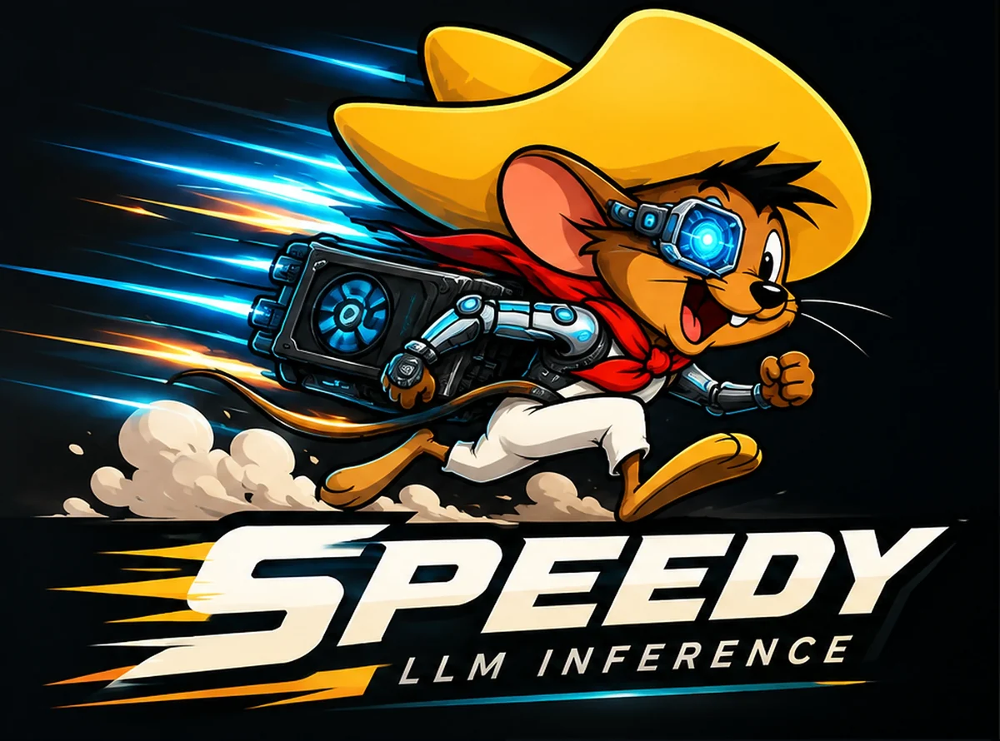

<div align="center">



### Speed you can feel. Answers you can trust. Agents that don't get stuck.

Run big open models (Qwen3.8-Flash-Next, DeepSeek V4.1-Flash, Qwen3.6) locally. Built for coding agents: no infinite loops, no broken tool calls, no answers cut off.

[](LICENSE)


-8A63D2)
[](https://ko-fi.com/devdock)

</div>

Speedy runs large mixture-of-experts models on consumer NVIDIA cards. Its main, most tuned model is
**Qwen3.8-Flash-Next** (125B MoE) with a **229K-token native context** and a **1M-token tier**; DeepSeek V4.1-Flash
and Qwen3.6-35B-A3B run too ([docs/MODELS.md](docs/MODELS.md)). It is a measured, tuned fork of [Strata](https://github.com/Niko1221/Strata).
Speed is half of it. The other half is what a local model usually gets wrong in real work: agents that loop, tool
calls that don't parse, thinking that runs out before the answer. Speedy 0.5.0 handles those on the server, so the
client you already use works better.

## Why Speedy

- 🎯 **Finishes real coding tasks.** 24/24 on our agentic suite (debugging, features, refactors, browser UI checked by screenshots), in 13.3 min instead of about 20.
- 🧠 **Thinks, then answers.** Medium reasoning with a 32K thinking budget by default, nudges at 60 % and 80 % so it wraps up, and room reserved so a reply is never cut off before the answer.
- 🔧 **Reliable tool calls.** Malformed calls are repaired, and a loop breaker stops an agent from repeating the same call over and over.
- ⚡ **Fast.** 115-168 tok/s decode on one RTX 3080 20 GB, 155-216 tok/s with a second card. A follow-up turn in a long conversation reads from cache.
- 📚 **Long context that holds.** 229K native, 1M tier. A session grown past 1M tokens still passed 9/9 recall checks.
- 🔌 **Drop-in API.** OpenAI- and Anthropic-compatible: OpenCode, Claude Code, Codex CLI and anything else that speaks those APIs. Images in chat are supported.

Every default can be turned off, and a request's own settings always win ([docs/SPEEDY_DEFAULTS.md](docs/SPEEDY_DEFAULTS.md)).

## Quality, measured

Qwen3.8-Flash-Next UD-Q4_K_XL, 1M-context preset, RTX 3080 20 GB + 10 GB. Tasks run through OpenCode against the real server.

| Test | Speedy 0.5.0 defaults | Previous defaults |
|:---|:---|:---|
| **Agentic coding suite**, 24 real tasks | **24/24** in 13.3 min | 21-24/24 in about 20 min |
| **Harder multi-file tasks**, 11 tasks / 86 checks | **9/11** (84/86 checks) in 10.7 min | 8/11 (76/86) in 12.2 min |
| **Tool calls well-formed** | **24/24**, 0 malformed | |
| **Needle recall**, greedy, about 214K tokens | **48/48** | |
| **IFBench**, 300 prompts, prompt-level loose | **81.0** | official BF16 card: 81.3 |

One run per arm on the agent suites, so read them as a direction, not a leaderboard; the IFBench gap is inside the
±2.3-point noise of a 300-prompt run ([`evals/`](evals/)). Engine changes are adopted only after a same-window A/B
and a quality gate: token-by-token comparison against the reference, a coding gate, and needle recall.

## Speed

Decode is with MTP speculative decoding. **short** is a short chat prompt, **code** a coding prompt, **55K** and
**110K** are prompts of about that many tokens. All values in tok/s.

### RTX 3080 20 GB (one card)

| Quant | Decode short | Decode code | Decode 55K | Decode 110K | Prefill short | Prefill code | Prefill 55K | Prefill 110K |
|:---|---:|---:|---:|---:|---:|---:|---:|---:|
| **Q2_0** <sub>fastest</sub> | **147** | **168** | **146** | **146** | 1,229 | 837 | 2,703 | 2,421 |
| **IQ3_S** | **110** | **125** | **127** | **120** | 1,125 | 765 \* | 2,481 | 2,235 |
| **UD-IQ3_XXS** | **139** | **151** | **142** | **134** | 968 | 603 | 2,725 | 2,489 |
| **UD-IQ4_XS** <sub>quality</sub> | **142** | **142** | **129** | **125** | 929 | 474 | 2,725 | 2,477 |
| **UD-Q4_K_XL** <sub>best</sub> | **122** | **121** | **122** | **115** | 729 | 346 | 2,409 | 2,200 |

<sub>0.4.8 engine, mean of 2 runs. \* one run; the other measured 28 tok/s (a measurement fault) and is left out. Presets: [`configs/cards/rtx3080-20gb/1x/`](configs/cards/rtx3080-20gb/1x/).</sub>

### RTX 3080 20 GB + RTX 3080 10 GB (layer split)

| Quant | Decode short | Decode code | Decode 55K | Decode 110K | Prefill short | Prefill code | Prefill 55K | Prefill 110K |
|:---|---:|---:|---:|---:|---:|---:|---:|---:|
| **Q2_0** <sub>fastest</sub> | **200** | **216** | **214** | **186** | 1,929 | 2,041 | 3,908 | 3,941 |
| **IQ3_S** | **205** | **196** | **184** | **195** | 1,644 | 1,726 | 3,990 | 4,037 |
| **UD-IQ3_XXS** | **197** | **210** | **204** | **180** | 1,590 | 1,710 | 3,679 | 3,957 |
| **UD-IQ4_XS** <sub>quality</sub> | **184** | **211** | **180** | **176** | 1,536 | 1,629 | 3,607 | 3,728 |
| **UD-Q4_K_XL** <sub>best</sub> | **168** | **170** | **161** | **155** | 1,226 | 1,300 | 2,950 | 3,150 |

<sub>0.4.6 engine, short speed screen. Presets (UD-Q4_K_XL, UD-IQ4_XS, UD-IQ3_XXS; 0.5 settings): [`configs/cards/rtx3080-20gb/2x/`](configs/cards/rtx3080-20gb/2x/).</sub>

Measured on Linux (Threadripper PRO 5975WX, 144 GB RAM), cards capped at 240 W / 280 W and unlocked with the optional
[gpu-unlock](docs/GPU-UNLOCK.md) module; without it expect lower prefill and the same decode. Plan for about 128 GB of
RAM on the Q4-class quants. Other GPUs, the 1M-token runs and the method: [docs/BENCHMARKS.md](docs/BENCHMARKS.md);
community results: [docs/COMMUNITY_BENCHMARKS.md](docs/COMMUNITY_BENCHMARKS.md).

## What's new in 0.5.0 ([changelog](CHANGELOG.md))

- **Smart reasoning defaults**: effort `medium`, 32K thinking budget, staged nudges, answer-room reserve.
- **Loop breaker** for agents: a repeated identical tool call gets a note naming the next step, then the tool is masked for one reply.
- **Tool-call repair**: broken calls are regenerated, argument shapes and types are fixed.
- **Thinking restored across turns**, so a tool-call conversation continues from cache instead of re-reading.
- **Stall and timeout guards**: a stuck request body or a client that stopped reading frees its slot.
- **Tuned MTP draft head**: faster decode with identical output.
- **Setup**: a tuned single-GPU profile by default, and a check that the size you pick fits your VRAM.

## Quick start: Linux

```bash
git clone https://github.com/DevDock-AI/Speedy.git speedy && cd speedy
export PATH=/usr/local/cuda/bin:$PATH
cmake -S . -B build -G Ninja -DCMAKE_BUILD_TYPE=Release -DSTRATA_ENABLE_CUDA=ON -DCMAKE_CUDA_ARCHITECTURES=86 \
      -DSTRATA_MMQ_KQUANTS=ON -DSTRATA_MMQ_TQ_OVERLAY=ON -DSTRATA_NATIVE_EXPERTS=ON -DSTRATA_Q6K_EXPERTS=ON
cmake --build build --target strata -j
python3 -m venv .venv && .venv/bin/pip install -r requirements.txt

./setup.sh        # downloads the GGUF, builds the packs and the draft head, writes a tuned config
# or run a measured preset: copy one from configs/cards/, fill in the placeholders, then
ulimit -l unlimited
.venv/bin/python serve/server.py --engine strata --config configs/mine/strata-ud-iq4_xs.json --port 8080
```

Set `-DCMAKE_CUDA_ARCHITECTURES` to your card (75 RTX 20, 86 RTX 30, 89 RTX 40, 120 RTX 50). Placeholders:
[docs/CONFIG-PLACEHOLDERS.md](docs/CONFIG-PLACEHOLDERS.md). Full steps: [docs/BUILD-LINUX.md](docs/BUILD-LINUX.md), [docs/MODELS.md](docs/MODELS.md). Set an API key before you
listen on anything other than `127.0.0.1` ([SECURITY.md](SECURITY.md)).

## Quick start: Windows

1. Clone the repository, or download and extract a [release](https://github.com/DevDock-AI/Speedy/releases/latest).
2. Run `START-HERE.bat` (in PowerShell: `.\START-HERE.bat`).
3. Pick the model and quant. On an RTX 20, 30, 40 or 50 card setup downloads a ready-made engine; on other cards it
   compiles from source (Visual Studio 2022 Build Tools and CUDA 13.x).

Expect somewhat lower prefill than on Linux. Building it yourself: [docs/SOURCE_INSTALL.md](docs/SOURCE_INSTALL.md#from-source-windows), [docs/INSTALL.md](docs/INSTALL.md).

## Presets

One folder per GPU model under [`configs/cards/`](configs/cards/), each with a `CARD.md` (hardware, build flags,
numbers). They are our measured configs with paths and GPU UUIDs replaced by placeholders.

| Folder | Contents |
|---|---|
| [`rtx3080-20gb/1x/`](configs/cards/rtx3080-20gb/1x/) | one RTX 3080 20 GB: every quant at 229K and 1M |
| [`rtx3080-20gb/2x/`](configs/cards/rtx3080-20gb/2x/) | RTX 3080 20 GB + RTX 3080 10 GB (layer split): UD-Q4_K_XL, UD-IQ4_XS, UD-IQ3_XXS with the 0.5 settings, plus `llama-swap.yaml` |
| [`rtx3080-10gb/1x/`](configs/cards/rtx3080-10gb/1x/), [`2x/`](configs/cards/rtx3080-10gb/2x/) | one and two RTX 3080 10 GB, plus `llama-swap.yaml` |

Got a different card? Copy [`configs/cards/_template/`](configs/cards/_template/) ([how](configs/README.md#add-a-card)),
or point an AI coding agent at this repo and let it tune a preset for your hardware ([docs/cards/](docs/cards/README.md)).
AMD builds through Strata's HIP backend ([docs/AMD_HIP.md](docs/AMD_HIP.md)); it compiles in CI but is untested.

## Updates

The server checks GitHub for a newer release in the background (anonymous, never installs anything by itself;
`STRATA_UPDATE_CHECK=0` turns it off). `./speedy-update` shows the release notes, asks, and updates
(Windows: `python serve\update.py`); `--check` only reports and `--rollback` goes back to what ran before.

## Documentation

| Document | Contents |
|---|---|
| [docs/BUILD-LINUX.md](docs/BUILD-LINUX.md), [docs/SOURCE_INSTALL.md](docs/SOURCE_INSTALL.md) | build and install, Linux and Windows |
| [docs/SPEEDY_DEFAULTS.md](docs/SPEEDY_DEFAULTS.md), [docs/CONFIGS.md](docs/CONFIGS.md) | the built-in defaults and every flag |
| [docs/BENCHMARKS.md](docs/BENCHMARKS.md) | method, hardware, full tables, noise floor |
| [docs/DETAILS.md](docs/DETAILS.md) | API routes, clients, images, server options |
| [docs/MULTI_GPU.md](docs/MULTI_GPU.md), [docs/TUNING-HISTORY.md](docs/TUNING-HISTORY.md) | layer split; everything tried, adopted and rejected |
| [docs/TROUBLESHOOTING.md](docs/TROUBLESHOOTING.md), [docs/upstream/](docs/upstream) | when something breaks; Strata's original guides |

## Contributing

Results from other GPUs are very welcome, on Windows too: open an issue with the **Performance report** template.
Speed claims need a same-window A/B, your hardware and a quality-gate result ([CONTRIBUTING.md](CONTRIBUTING.md)); security issues go privately ([SECURITY.md](SECURITY.md)).

## License

Speedy Personal & Non-Commercial License v1.0 ([LICENSE](LICENSE)) for original Speedy contributions: free to run, study, modify and use for personal, non-commercial purposes (AI-assisted changes included); commercial use or public redistribution of modified versions needs written permission. Speedy is built on [Strata](https://github.com/Niko1221/Strata) (MIT, [licenses/Strata-MIT.txt](licenses/Strata-MIT.txt)); third-party components keep their own licenses (see [licenses/](licenses/)). Model weights are not included and keep their own licenses.

---

<sub><b>Credits.</b> Built on <a href="https://github.com/Niko1221/Strata">Strata</a> by Niko1221 and the Strata contributors.
Dual-GPU groundwork from Hardin22's Strata-DualGPU. Upstream work carried: lask3802 (#2689/#2690), Stefano Sinden / bitaccesscomau (#4283, #4119),
merbanan (#4039), havok2-htwo (#3559), cobra91, chimpera, moses-sun, wannagoxuf, ruibeikaa, Klaus Friedel, Gopi, Jackwwg83 (#4567),
Zac Chen / xyzzing (#3919), sergqwer (#2968, #2964), gopinath87607 (#3307, #3309, #3310), G0-0000 (#4226).
Ideas: StrataFast, architectds (IMMA attention), Cloudflare Code Mode.
Optional: <a href="https://github.com/Zagitta/gpu-unlock">gpu-unlock</a> (Zagitta). Kernels derived from <a href="https://github.com/ggml-org/llama.cpp">llama.cpp / ggml</a>.
Models: <a href="https://huggingface.co/Qwen">Qwen</a>, <a href="https://huggingface.co/unsloth">Unsloth</a> UD quants,
<a href="https://huggingface.co/ISTA-DASLab">ISTA-DASLab</a> GSQ-RCO quants. Benchmarks: <a href="https://github.com/allenai/IFBench">IFBench</a>, LiveCodeBench.
Full attribution: <a href="NOTICE">NOTICE</a>.</sub>

<div align="center"><br>If Speedy saved you some GPU money, <a href="https://ko-fi.com/devdock">buy me a coffee</a> ☕</div>
